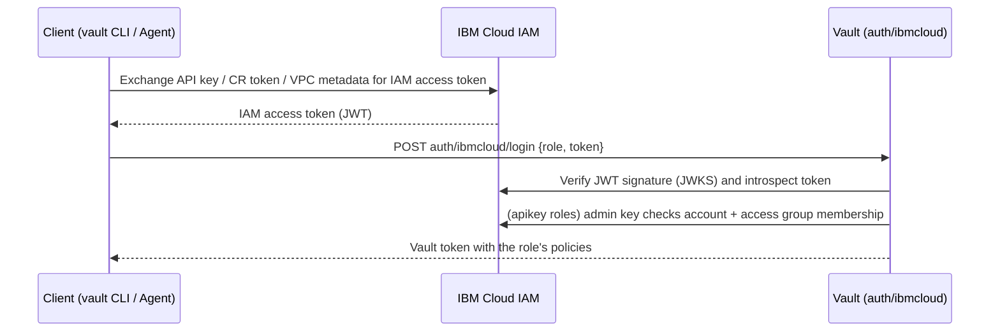

# Vault IBM Cloud Auth Method: Quick Start Guide

This guide is for people who **log in to Vault with an IBM Cloud identity**. It covers:

1. What IBM Cloud setup is needed and which IAM roles to grant
2. How to configure Vault (config, policies, roles)
3. Every way to log in (API key, env var, IAM token, raw API, user)
4. How to check Vault policies **with and without access groups**
5. How to use a **trusted profile** (VPC virtual server, no stored secret)
6. How to run **Vault Agent** with the `ibmcloud` auto-auth method
7. Troubleshooting and known limitations

All commands assume you run them from the repository root, where `./bin/vault` is the locally built binary
(`./build-vault-with-ibmcloud.sh` or `make dev`).

---

## 1. How it works



Key points:

- **Vault never sees your API key.** The client exchanges it with IAM and sends only the short-lived IAM access token.
- The identity type in the token decides the role type:

  | IAM `sub_type` | Identity | Vault role `type` |
  |---|---|---|
  | `User` | IBMid user | `apikey` |
  | `ServiceId` | Service ID | `apikey` |
  | `Profile` | Trusted profile (compute resource) | `trusted_profile` |

  A role of one type will reject a token of the other type.
- Vault needs its **own admin API key** to check that API-key identities belong to your account and to
  check access groups. Trusted profile logins do not use it for membership checks.

> **Important:** `bound_access_group_ids` and the account-membership lookups are only enforced when the
> auth method is configured with `api_key` **and** `account_id` (section 3.2). Without them, access
> group bindings on a role are silently ignored.

---

## 2. IBM Cloud setup

### 2.1 Prerequisites

- An IBM Cloud account and the [`ibmcloud` CLI](https://cloud.ibm.com/docs/cli), logged in to it.
- `jq` and `curl`.
- Permission in the account to create service IDs, API keys, access groups and IAM policies.

```bash
ibmcloud login --sso                      # or: ibmcloud login --apikey <key>
export ACCOUNT_ID=$(ibmcloud target --output json | jq -r '.account.guid')
export IAM_ENDPOINT=https://iam.cloud.ibm.com   # use https://iam.test.cloud.ibm.com for the test environment
```

> The IAM endpoint used by the **client** (`iam_endpoint=` at login, or in the Agent config) and the one
> configured in **Vault** (`auth/ibmcloud/config`) must point to the **same IBM Cloud environment**.
> A token minted in one environment is rejected by the other.

### 2.2 Create Vault's admin service ID and API key (once)

Vault uses this identity to verify who is logging in. The helper script creates a service ID with
least-privilege access, saves the key to a mode-600 file (never printed) and tests the access:

```bash
./create-admin-apikey.sh                       # service ID: vault-ibmcloud-admin
# options: -n NAME   -o KEYFILE   --skip-user-lookup   --skip-verify
```

IAM access it grants to the new service ID:

| # | IAM role | Service | Scope | Why Vault needs it |
|---|---|---|---|---|
| 1 | Viewer | `iam-identity` | all service IDs | Login: `GET /v1/serviceids/{id}`, confirms a service ID belongs to the account |
| 2 | Operator | `iam-identity` | resource type `serviceid`, **only itself** | `rotate-root`: create, read and delete API keys of this service ID only |
| 3 | Viewer | `user-management` | account | Login: `GET /v2/accounts/{account}/users/{id}` for **User** identities. Skip with `--skip-user-lookup` if only service IDs log in |

Do the same by hand with the CLI:

```bash
ibmcloud iam service-id-create vault-ibmcloud-admin -d "Vault ibmcloud auth admin"
SID=$(ibmcloud iam service-id vault-ibmcloud-admin --output json | jq -r '.id')

ibmcloud iam service-policy-create "$SID" --roles Viewer   --service-name iam-identity
ibmcloud iam service-policy-create "$SID" --roles Operator --service-name iam-identity \
    --resource-type serviceid --resource "$SID"
ibmcloud iam service-policy-create "$SID" --roles Viewer   --service-name user-management

ibmcloud iam service-api-key-create vault-ibmcloud-admin-key "$SID" --file ~/vault-ibmcloud-admin.apikey.json
```

Policies can take up to a minute to propagate.

### 2.3 What the logging-in identities need

For **API key** logins the identity needs **no IAM policies at all**. Vault only needs to identify it:

- It must belong to the account in `bound_account_id`.
- Optionally it is pinned by `bound_service_ids` / `bound_user_ids`, and/or by membership in an access group
  (`bound_access_group_ids`).

For **trusted profile** logins see section 6.

---

## 3. Vault setup

### 3.1 Start a dev server

```bash
./restart-vault-dev.sh                  # or: ./bin/vault server -dev -dev-root-token-id=root
export VAULT_ADDR=http://127.0.0.1:8200
export VAULT_TOKEN=root
./bin/vault auth enable ibmcloud
```

### 3.2 Configure the auth method

```bash
./bin/vault write auth/ibmcloud/config \
    iam_endpoint="$IAM_ENDPOINT" \
    api_key="$(jq -r .apikey ~/vault-ibmcloud-admin.apikey.json)" \
    account_id="$ACCOUNT_ID" \
    service_id="$SID"                    # optional: only needed for rotate-root
```

| Field | Notes |
|---|---|
| `iam_endpoint` | Default `https://iam.cloud.ibm.com` |
| `api_key` | Admin key from 2.2. Write-only, never returned on read. Requires `account_id` |
| `account_id` | Account every login must belong to. Requires `api_key` |
| `service_id` | Service ID that owns `api_key`. Only for `vault write -f auth/ibmcloud/config/rotate-root` |
| `iam_client_timeout` | Seconds, default 30 |

Optionally rotate the root key so only Vault holds a valid copy, then delete the key file:

```bash
./bin/vault write -f auth/ibmcloud/config/rotate-root
```

### 3.3 Create Vault policies

The repo ships two sample policies on `secret/myapp/*`:

```bash
./bin/vault policy write my-policy        my-policy.hcl          # read, list
./bin/vault policy write my-writer-policy my-writer-policy.hcl   # create, read, update, delete, list
./bin/vault kv put secret/myapp/config password=s3cr3t           # seed a test secret (dev server has KV v2 at secret/)
```

### 3.4 Roles reference

A role maps an IBM Cloud identity to Vault policies.

**`type=apikey`** (users and service IDs)

| Parameter | Required | Meaning |
|---|---|---|
| `bound_account_id` | yes | Account the identity must belong to |
| `bound_service_ids` | no | Allowed service IDs. Matches `iam-ServiceId-...` (the IAM ID) |
| `bound_user_ids` | no | Allowed users. Matches `IBMid-...` |
| `bound_access_group_ids` | no | Identity must be a member of **all** listed groups (`AccessGroupId-...`) |

**`type=trusted_profile`** (compute resources)

| Parameter | Required | Meaning |
|---|---|---|
| `bound_trusted_profile_id` | yes | Trusted profile ID (`Profile-...`) |
| `bound_compute_resource_crn`, `bound_compute_resource_type` | no | See known limitations (section 9) before using |

Both types accept the standard Vault token parameters: `token_policies`, `token_ttl`, `token_max_ttl`,
`token_period`, `token_bound_cidrs`, and so on.

`demo-setup.sh` does 3.1 to 3.4 in one go:

```bash
./demo-setup.sh "$(jq -r .apikey ~/vault-ibmcloud-admin.apikey.json)" "$ACCOUNT_ID" "$SID" [ACCESS_GROUP_ID]
```

It creates `my-service-role` (read) and `my-service-writer-role` (write). If you pass an access group ID,
both roles are bound to it.

---

## 4. Logging in

Create a simple role first. This one lets **one specific service ID** in your account in:

```bash
./create-tester-apikey.sh -n vault-tester         # creates the service ID and key, prints the role command
```

The script prints the exact `IAM ID` and a ready-made role command. It looks like this:

```bash
./bin/vault write auth/ibmcloud/role/tester-role \
    type=apikey \
    bound_account_id="$ACCOUNT_ID" \
    bound_service_ids=iam-ServiceId-xxxxxxxx \
    token_policies=my-policy token_ttl=1h token_max_ttl=24h
```

### 4.1 API key on the command line

```bash
./bin/vault login -method=ibmcloud role=tester-role \
    apikey="$(jq -r .apikey ~/vault-tester.apikey.json)" \
    iam_endpoint="$IAM_ENDPOINT"
```

### 4.2 API key from the environment

The CLI reads `IBMCLOUD_API_KEY` automatically, so the key stays out of your shell history:

```bash
export IBMCLOUD_API_KEY=$(jq -r .apikey ~/vault-tester.apikey.json)
./bin/vault login -method=ibmcloud role=tester-role iam_endpoint="$IAM_ENDPOINT"
```

### 4.3 An IAM access token you already have

Exchange the key yourself, or reuse a token. The token must be passed **without** the `Bearer ` prefix:

```bash
TOKEN=$(curl -s -X POST "$IAM_ENDPOINT/identity/token" \
    -d grant_type=urn:ibm:params:oauth:grant-type:apikey \
    --data-urlencode "apikey=$IBMCLOUD_API_KEY" | jq -r .access_token)

./bin/vault login -method=ibmcloud role=tester-role token="$TOKEN"
```

For your own interactive `ibmcloud login` session, `ibmcloud iam oauth-tokens` prints `IAM token: Bearer ...`.
Strip the `Bearer ` part. Such a token has `sub_type=User`, so it needs an `apikey` role (see 4.5).

### 4.4 Raw HTTP API

This is what the CLI and Agent do under the hood. Any language works:

```bash
curl -s --request POST "$VAULT_ADDR/v1/auth/ibmcloud/login" \
    --data "{\"role\":\"tester-role\",\"token\":\"$TOKEN\"}" | jq .auth
```

### 4.5 Logging in as a human user

Users log in with the same `apikey`-type roles. Pin them by IBMid, or by access group:

```bash
./bin/vault write auth/ibmcloud/role/alice-role \
    type=apikey bound_account_id="$ACCOUNT_ID" \
    bound_user_ids="IBMid-xxxxxxxxxx" token_policies=my-policy
```

This requires the admin key to have **Viewer on `user-management`** (2.2, row 3). Find your IBMid with
`ibmcloud account users`.

### 4.6 Useful options

| Goal | How |
|---|---|
| Print only the Vault token | `vault login -no-store -token-only -method=ibmcloud ...` |
| Mount at a different path | `vault login -path=my-ibm -method=ibmcloud ...` |
| Restrict by client IP | `token_bound_cidrs=10.0.0.0/8` on the role |
| See what you got | `vault token lookup`. Metadata shows `account_id`, `iam_id`, `auth_type` |

---

## 5. Tutorial: checking policies with and without access groups

Goal: prove that Vault grants different policies depending on **access group membership**, and that a role
with **no** group binding lets in anyone from the account.

### 5.1 Create the access groups and three test identities

```bash
ibmcloud iam access-group-create vault-readers -d "Vault read-only users"
ibmcloud iam access-group-create vault-writers -d "Vault read-write users"

READERS_ID=$(ibmcloud iam access-groups --output json | jq -r '.[] | select(.name=="vault-readers") | .id')
WRITERS_ID=$(ibmcloud iam access-groups --output json | jq -r '.[] | select(.name=="vault-writers") | .id')

./create-tester-apikey.sh -n vault-tester-nogroup                          # in NO group
./create-tester-apikey.sh -n vault-tester-reader  -g vault-readers         # member of vault-readers
./create-tester-apikey.sh -n vault-tester-writer  -g vault-writers         # member of vault-writers
```

Each run saves `~/<name>.apikey.json`. The script also verifies, as Vault will see it, that the service ID is
a member of the group.

> Access groups need no IAM policies for this test. Membership alone is what Vault checks. In real life you
> attach IAM policies to the group so members also get IBM Cloud permissions.

### 5.2 Create three roles

```bash
# A) no access group: anyone in the account may log in, gets the read policy
./bin/vault write auth/ibmcloud/role/open-role \
    type=apikey bound_account_id="$ACCOUNT_ID" token_policies=my-policy

# B) only vault-readers members, read policy
./bin/vault write auth/ibmcloud/role/readers-role \
    type=apikey bound_account_id="$ACCOUNT_ID" \
    bound_access_group_ids="$READERS_ID" token_policies=my-policy

# C) only vault-writers members, write policy
./bin/vault write auth/ibmcloud/role/writers-role \
    type=apikey bound_account_id="$ACCOUNT_ID" \
    bound_access_group_ids="$WRITERS_ID" token_policies=my-writer-policy
```

> Role A is only for demonstrating the "no group" case. In production, always narrow a role with
> `bound_access_group_ids`, `bound_service_ids`, or `bound_user_ids`. Otherwise **any** API key from the
> account can obtain that role's policies.

### 5.3 Test the matrix

```bash
try() {   # try <role> <keyfile>  ->  prints the Vault token, or the error
    ./bin/vault login -no-store -token-only -method=ibmcloud role="$1" \
        apikey="$(jq -r .apikey "$2")" iam_endpoint="$IAM_ENDPOINT"
}

for role in open-role readers-role writers-role; do
  for who in nogroup reader writer; do
    printf '%-14s as %-8s: ' "$role" "$who"
    if try "$role" ~/vault-tester-$who.apikey.json >/dev/null 2>/tmp/err; then echo "LOGIN OK"
    else echo "DENIED  ($(grep -o 'user is not a member[^"]*' /tmp/err | head -1))"; fi
  done
done
```

Expected result:

| Identity ↓ / Role → | `open-role` | `readers-role` | `writers-role` |
|---|---|---|---|
| `vault-tester-nogroup` | OK | denied | denied |
| `vault-tester-reader` | OK | OK | denied |
| `vault-tester-writer` | OK | denied | OK |

The denial message is `user is not a member of required access groups`.

### 5.4 Check what the Vault policy allows

Log in and exercise the token against `secret/myapp/config`:

```bash
RT=$(try readers-role ~/vault-tester-reader.apikey.json)
VAULT_TOKEN=$RT ./bin/vault kv get secret/myapp/config                    # allowed (read)
VAULT_TOKEN=$RT ./bin/vault kv put secret/myapp/config password=hacked    # permission denied

WT=$(try writers-role ~/vault-tester-writer.apikey.json)
VAULT_TOKEN=$WT ./bin/vault kv put secret/myapp/config password=newpass   # allowed (write)

./bin/vault token capabilities "$RT" secret/data/myapp/config   # read, list
./bin/vault token capabilities "$WT" secret/data/myapp/config   # create, delete, list, read, update
```

### 5.5 Verify membership from IBM Cloud's side

If a login is unexpectedly denied, check what IAM reports for the identity:

```bash
ibmcloud iam access-group-service-id-add vault-readers <service-id>   # add
ibmcloud iam access-group vault-readers                                 # show group details
ibmcloud iam access-group-service-ids vault-readers                     # list service ID members
```

Membership changes can take a few seconds to show up.

### 5.6 Combining bindings

All bindings on a role are **ANDed**. For example, a role that accepts only one specific service ID *and*
only when it is in a given group:

```bash
./bin/vault write auth/ibmcloud/role/strict-role \
    type=apikey bound_account_id="$ACCOUNT_ID" \
    bound_service_ids="iam-ServiceId-xxxx" \
    bound_access_group_ids="$READERS_ID" token_policies=my-policy
```

---

## 6. Tutorial: trusted profiles (no stored secret)

A **trusted profile** lets a compute resource (here a VPC virtual server instance, VSI) become an IBM Cloud
identity without any API key. The instance asks its **metadata service** for a token, exchanges it for an IAM
access token, and Vault accepts that token for a `trusted_profile` role. Nothing secret is stored on the VM.

### 6.1 Create the trusted profile and link it to the VSI

```bash
ibmcloud iam trusted-profile-create vault-vsi-profile -d "Profile for Vault clients on VSIs"
PROFILE_ID=$(ibmcloud iam trusted-profile vault-vsi-profile --output json | jq -r '.id')   # Profile-xxxx
echo "$PROFILE_ID"
```

Trust a **single instance** with a link:

```bash
VSI_CRN=$(ibmcloud is instance <instance-name> --output JSON | jq -r '.crn')
ibmcloud iam trusted-profile-link-create "$PROFILE_ID" \
    --name vault-vsi-link --cr-type VSI --link-crn "$VSI_CRN"
```

or trust **all instances of a VPC** with a rule:

```bash
ibmcloud iam trusted-profile-rule-create "$PROFILE_ID" --name vault-vpc-rule \
    --type Profile-CR --cr-type VSI \
    --conditions "claim:vpc_id,operator:EQUALS,value:<vpc-id>"
```

The instance must have its **metadata service enabled** (an instance setting in VPC; see the VPC
documentation). No IAM policies are required on the profile for Vault.
Vault only introspects the profile's token. Grant policies only if the workload needs IBM Cloud access too.

### 6.2 Create the Vault role

Run this on the Vault side:

```bash
./bin/vault write auth/ibmcloud/role/vsi-role \
    type=trusted_profile \
    bound_trusted_profile_id="$PROFILE_ID" \
    token_policies=my-policy token_ttl=1h token_max_ttl=24h
```

When `account_id` is set in `auth/ibmcloud/config` (section 3.2), Vault also checks that the profile's token
comes from your account.

### 6.3 Log in from the VSI

SSH to the instance (Vault address must be reachable from it):

```bash
export VAULT_ADDR=http://<vault-host>:8200

# the instance's default trusted profile
vault login -method=ibmcloud role=vsi-role type=trusted_profile iam_endpoint="$IAM_ENDPOINT"

# or name the profile explicitly (needed if the instance has no default profile)
vault login -method=ibmcloud role=vsi-role type=trusted_profile \
    trusted_profile_id="$PROFILE_ID" iam_endpoint="$IAM_ENDPOINT"
```

What happens (see `ExchangeVPCMetadata` in `builtin/credential/ibmcloud/client.go`):

1. `PUT  http://169.254.169.254/identity/v1/token` → instance identity token
2. `POST http://169.254.169.254/identity/v1/iam_tokens` (optionally with `trusted_profile.id`) → IAM access token
3. `POST $VAULT_ADDR/v1/auth/ibmcloud/login` with `role` and `token`

`vault token lookup` then shows `trusted_profile_id` (and `compute_resource_id`/`crn` when present) in the
token metadata.

CLI parameters for trusted profiles:

| Parameter | Meaning |
|---|---|
| `type=trusted_profile` | Required to use the metadata path. This also stops the CLI from picking up `IBMCLOUD_API_KEY` |
| `trusted_profile_id` | Profile to use. Optional when the instance has a default profile |
| `metadata_endpoint` | Default `http://169.254.169.254` |
| `cr_token` | Use an explicit compute resource token instead of the metadata service (for example a Kubernetes service-account token); combine with `trusted_profile_id` |
| `iam_endpoint` | Must match the environment Vault is configured for |

### 6.4 Test the policy

```bash
vault kv get secret/myapp/config                 # allowed by my-policy
vault kv put secret/myapp/config x=y             # permission denied (read-only policy)
```

---

## 7. Tutorial: Vault Agent with the `ibmcloud` auto-auth method

Vault Agent logs in for your application, keeps the Vault token renewed, re-authenticates when it expires,
and can render secrets to files or proxy requests. The `ibmcloud` method supports both identity types.

### 7.1 Agent with an API key

Put the key in the environment, not the config file:

```bash
export IBMCLOUD_API_KEY=$(jq -r .apikey ~/vault-tester-reader.apikey.json)
```

`agent-apikey.hcl`:

```hcl
pid_file = "./agent.pid"

vault {
  address = "http://127.0.0.1:8200"
}

auto_auth {
  method {
    type       = "ibmcloud"
    mount_path = "auth/ibmcloud"          # default is auth/<type>
    config = {
      role         = "readers-role"
      type         = "apikey"
      iam_endpoint = "https://iam.cloud.ibm.com"
      # apikey is read from IBMCLOUD_API_KEY when not set here
    }
  }

  sink "file" {
    config = {
      path = "/tmp/vault-token"
    }
  }
}

# Local listener that injects the auto-auth token into proxied requests
listener "tcp" {
  address     = "127.0.0.1:8100"
  tls_disable = true
}

api_proxy {
  use_auto_auth_token = true
}

# Render a secret to a file; re-rendered when the secret changes
template {
  contents    = "{{ with secret \"secret/data/myapp/config\" }}{{ .Data.data.password }}{{ end }}"
  destination = "/tmp/myapp-password.txt"
}
```

Run it:

```bash
./bin/vault agent -config=agent-apikey.hcl
```

Verify (in another terminal):

```bash
cat /tmp/vault-token                                      # the Vault token the agent obtained
cat /tmp/myapp-password.txt                               # rendered secret
VAULT_ADDR=http://127.0.0.1:8100 VAULT_TOKEN= ./bin/vault kv get secret/myapp/config   # through the agent proxy, no token needed
```

### 7.2 Agent on a VSI with a trusted profile (no secret at all)

`agent-vsi.hcl` on the instance:

```hcl
vault {
  address = "http://<vault-host>:8200"
}

auto_auth {
  method {
    type = "ibmcloud"
    config = {
      role               = "vsi-role"
      type               = "trusted_profile"
      trusted_profile_id = "Profile-xxxxxxxx"   # optional if the instance has a default profile
      iam_endpoint       = "https://iam.cloud.ibm.com"
      # metadata_endpoint        = "http://169.254.169.254"
      # credential_poll_interval = 60            # seconds
    }
  }

  sink "file" {
    config = {
      path = "/home/vpcuser/.vault-token"
      mode = 0600
    }
  }
}
```

```bash
vault agent -config=agent-vsi.hcl
```

Notes on Agent behavior:

- **`type`** may be omitted: it is inferred as `apikey` if `apikey` is set or `IBMCLOUD_API_KEY` is in the
  environment, and as `trusted_profile` if `cr_token` or `trusted_profile_id` is set.
- **Trusted profile** (metadata): the Agent polls the metadata service every `credential_poll_interval`
  seconds (default 60) and re-authenticates when the IAM token it receives differs from the one it last used.
  If you see more logins in the Vault audit log than expected, raise this value.
- **Static `cr_token`**: no polling is started. Use it for a CR token mounted as a file/secret.
- Agent config keys: `role` (required), `type`, `apikey`, `cr_token`, `trusted_profile_id`, `iam_endpoint`,
  `metadata_endpoint`, `credential_poll_interval`.
- `namespace`, `wrap_ttl`, and sink encryption settings work as for other auto-auth methods.

---

## 8. Troubleshooting

| Error (from Vault or CLI) | Likely cause and fix |
|---|---|
| `role "x" not found` | Role name typo, or wrong `-path`/`mount` |
| `token verification failed: ...` | Token expired or inactive, signed by a different IAM environment, or still has the `Bearer ` prefix. Check that `iam_endpoint` on client and Vault match |
| `role type "apikey" does not match token identity type "trusted_profile"` | You used a role of the wrong type. Users and service IDs need `apikey` roles, profiles need `trusted_profile` roles |
| `account verification failed: identity account X does not match configured account Y` | Identity is from another account |
| `account verification failed: failed to verify service ID: ... status 403` | Admin key lacks **Viewer on `iam-identity`** (2.2, row 1). Allow a minute for propagation |
| `account verification failed: ... user ...` | Admin key lacks **Viewer on `user-management`**, or the user is not in the account |
| `user is not a member of required access groups` | Identity is not a member of **all** groups in `bound_access_group_ids`. Re-check 5.5 |
| `identity validation failed: service ID ... not in allowed list` | `bound_service_ids` must use the **IAM ID** (`iam-ServiceId-...`). `create-tester-apikey.sh` prints it |
| `trusted profile ID ... does not match bound profile ID ...` | Wrong `bound_trusted_profile_id`, or a different profile was used. Pass `trusted_profile_id=` explicitly |
| `metadata IAM token exchange failed ... (if the instance does not have a default trusted profile, specify trusted_profile_id)` | VSI has no default profile. Pass `trusted_profile_id` and make sure the profile is linked to the instance |
| `failed to fetch metadata identity token` | Not running on a VSI, or the metadata service is disabled |
| `one of 'token', 'apikey' (or IBMCLOUD_API_KEY), 'cr_token', or running on a VPC instance...` | The CLI had no credentials at all. Provide one (section 4) |
| `request originated from invalid CIDR` | Client IP is outside the role's `token_bound_cidrs` |
| Access group role lets everyone in | Auth method was configured **without** `api_key`/`account_id`. See section 1 |

Debugging tips:

- Check what Vault is configured with: `vault read auth/ibmcloud/config` (the API key is never shown).
- Inspect a token's claims: `curl -s -X POST $IAM_ENDPOINT/identity/introspect -d token=$TOKEN | jq`
  (look at `sub_type`, `iam_id`, `account.bss`).
- Run the server with `-log-level=debug` to see the IAM calls Vault makes during login.

---

## 9. Known limitations

These are properties of the current implementation (`builtin/credential/ibmcloud`):

- **`bound_compute_resource_crn` and `bound_compute_resource_type` are not reliable yet.** `matchCRNPattern` only
  matches the pattern `*`; other patterns are never matched, so the login is rejected. `bound_compute_resource_type`
  compares against the 9th CRN segment (for a VSI this is `instance`, not `vsi`). Until fixed, restrict trusted
  profile logins with `bound_trusted_profile_id` and scope **the profile itself** (link to a specific instance,
  or a rule on `vpc_id`/`crn`) on the IBM Cloud side.
- **Access groups are checked for `apikey` roles only**, and only when the admin `api_key` and `account_id`
  are configured.
- **Tokens carry no Vault-specific audience.** The account check and role bindings are the guard against token
  reuse, so always bind roles tightly (service ID, user, or group).
- **No `bound_*` for trusted profile account** beyond the global `account_id`: set `account_id` in the config
  to have the profile's account verified.

---

## 10. Clean up

```bash
ibmcloud iam service-id-delete vault-tester-nogroup -f
ibmcloud iam service-id-delete vault-tester-reader  -f
ibmcloud iam service-id-delete vault-tester-writer  -f
ibmcloud iam access-group-delete vault-readers -f
ibmcloud iam access-group-delete vault-writers -f
ibmcloud iam trusted-profile-delete vault-vsi-profile -f
rm -f ~/vault-tester-*.apikey.json

./bin/vault auth disable ibmcloud        # removes the method together with its roles and config
```

---

## Cheat sheet

```bash
# one-time setup
./create-admin-apikey.sh
./bin/vault auth enable ibmcloud
./bin/vault write auth/ibmcloud/config iam_endpoint=$IAM_ENDPOINT api_key=... account_id=$ACCOUNT_ID service_id=$SID

# service ID / user role
./bin/vault write auth/ibmcloud/role/R type=apikey bound_account_id=$ACCOUNT_ID \
    [bound_service_ids=iam-ServiceId-...] [bound_user_ids=IBMid-...] [bound_access_group_ids=AccessGroupId-...] \
    token_policies=P

# trusted profile role
./bin/vault write auth/ibmcloud/role/R type=trusted_profile bound_trusted_profile_id=Profile-... token_policies=P

# logins
vault login -method=ibmcloud role=R apikey=...                        # or IBMCLOUD_API_KEY
vault login -method=ibmcloud role=R token=<IAM access token>
vault login -method=ibmcloud role=R type=trusted_profile [trusted_profile_id=Profile-...]
vault agent -config=agent.hcl                                         # method { type = "ibmcloud" }
```
